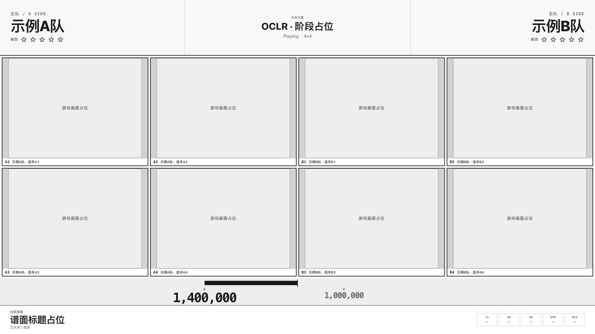

# OCLR 直播 Overlay

OCLR 赛事直播项目，集中保存**直播数据基础层**与**浏览器 UI 布局线框**。两部分目前独立运行，尚未把真实数据接入画面，也未完成真实 tosu / osu! tourney / OBS 联调。

## 当前内容

| 路径 | 内容 |
| --- | --- |
| `server/` | 仅本机监听的 OCLR 只读 API 代理，凭证只留在服务端 |
| `src/` | OCLR API、tosu v2 WebSocket 与统一订阅入口 |
| `test/` | 数据边界、分页、断线与凭证隔离测试 |
| [`design/layout-v1/`](design/layout-v1/layout-plan.md) | 六场景低保真评审页、布局决策、预览及参考截图 |

数据服务的 `/` 当前返回状态 JSON；UI 线框通过独立预览地址打开。

## UI 布局预览

在项目根目录运行：

```sh
python3 -m http.server 3002 --bind 127.0.0.1 --directory design/layout-v1
```

打开 <http://127.0.0.1:3002/>。只提供该线框目录，**不要把项目根目录作为静态 HTTP 根目录**。

- 场景：等待选手、Mappool Ban/Pick、Playing、单图结算、全场胜利、暂停 / 技术处理。
- 支持 3v3 / 4v4、4:3 / 16:9 游戏源比例、干净输出与 URL 状态恢复。
- Playing 分差带从固定中线向领先一侧延伸，领先数字随外端移动；单图结算保留相同位置的原生 osu! 结算窗口，并展示最终队伍总分。
- 当前所有分数均为本地演示，游戏与原生结算画面均为占位。OCLR 是赛事品牌，OWC 2019 仅是布局参考。
- 按 `1`–`6` 切场景、`C` 切换干净输出、`Esc` 退出干净输出。详细决策见[布局规划](design/layout-v1/layout-plan.md)。



## 数据来源

| 来源 | 用途 | 入口 |
| --- | --- | --- |
| tosu | 游戏状态、当前谱面、单人/Showcase 成绩、赛事客户端、实时队分、星数、聊天 | `ws://127.0.0.1:24050/websocket/v2` |
| OCLR 网站 | 已发布赛季、队伍/队员、赛程、正式结果、图池、晋级结构 | `https://oclr.org/api/v1` |
| 直播员选择 | 当前赛季、场次、图池、左右队伍、重复谱面槽位 | `BroadcastData.selectEdition/selectMatch`，仅在内存中 |

不生成或维护 `bracket.json`，不连接数据库。实时星数和游戏成绩与 API 中的正式结果分别保存；不因名字相同而自动绑定队伍。不从其他赛季借用空缺资料，也不从比赛结束事件自动写入正式结果。API 的 `/bracket` 仍可读取，它是线上晋级结构资源。

## 运行数据服务

需要 Node.js 22.13+（本机验证使用 24.16），无第三方运行依赖，无须 `npm install`。

```sh
# 在项目根目录运行
cp .env.example .env.local # 仅初次配置；已有文件不要覆盖
npm start
```

服务地址为 `http://localhost:3001`，仅监听 `127.0.0.1`，与现有 `3000` 网站分开。

`.env.example` 默认以匿名模式读取 `https://oclr.org`。需要 Bearer 认证时，在不提交 Git 的 `.env.local` 中设置 `OCLR_AUTH_MODE=bearer`，并填写 `OCLR_API_KEY` 或将 `OCLR_CREDENTIALS_FILE` 指向已有的服务端凭证文件；相对路径以项目根目录解析。前端不接收 Key。仓库不包含任何本机 `.env.local` 或凭证文件，克隆后需自行配置。

`OCLR_API_ORIGIN` 必须与 Key 获发时绑定的 Origin 一致，由服务端发送，与本服务端口独立配置。Key 失效时返回 401/403，停止自动刷新并清空赛事快照。更新凭证后重启服务，再调用 `refresh()`。不会自动降级匿名。若明确使用公开匿名数据，将 `OCLR_AUTH_MODE` 设为 `anonymous` 后重启。

`.env.local` 和凭证文件绝不能通过静态 HTTP 服务器公开。本项目的 Node 服务只公开四个指定的浏览器模块和允许的 API；不要对整个工作区或项目使用 `python -m http.server`。

## 给后续 UI 的入口

未来接入真实数据的 UI 应由本项目的本地服务同源提供。当前线框尚未订阅数据，也未加入数据服务的静态路由；接线时需要在 `server/app.js` 中增加明确的前端资源目录，并保持凭证文件不可访问。

```js
import { createBroadcastData } from '/src/index.js';

const data = await createBroadcastData();
const unsubscribe = data.subscribe(state => {
  // state.oclr: status / updatedAt / error / data
  // state.tosu: status / updatedAt / data
  // state.selection: 当前赛季、场次、图池、左右队伍 ID
  // state.currentPoolEntry: 唯一匹配的谱面槽位，或 null
  // UI 按 status 决定是否显示内容，禁止把旧快照当作 live。
});

await data.selectEdition('s11');
// 从已取得的数据中选择真实 ID；空列表时保留未选择状态。
// data.selectMatch({ fixtureId, poolId, leftTeamId, rightTeamId, entryId });
data.start();

// 页面/场景销毁时：
// unsubscribe();
// data.stop();
```

独立的 `OclrClient.tournaments()` 可用于赛季选择器，`edition(slug)` 读取赛季资料。服务器也允许读取单场 `/api/oclr/tournaments/{edition}/matches/{uuid}`；历史归档的场次键可能不是 UUID，应保留 `/bracket` 数据，不能猜成当前赛事 fixture ID。

赛事快照按顺序读取 overview、teams、competition、mappools、bracket 和完整 players，每 60 秒刷新（可配置，最低 30 秒）。这些跨资源读取**不是数据库原子快照**，`updatedAt` 只是本地成功读取时间；正式来源时间/版本仍以各资源内容为准。分页集合带版本，409 后整份重读一次；不会返回半份名单。429 遵守 `Retry-After`。失败状态与真实空集合分开。

tosu 默认 5 秒无有效帧标记 stale 并重连，断线每秒重试；`stop()` 取消重连。每个新帧替换旧客户端列表，避免上一场选手残留。缺失数字保留 null，真实 0 保留 0。不在此阶段自动判定胜负、实现 Ban/Pick 规则或做动画。

## 参考与验收

- 官方 tosu：[项目与端点](https://github.com/tosuapp/tosu)、[v2 字段示例](https://github.com/tosuapp/tosu/wiki/v2-websocket-api-response)。公开文档对赛事数据标注了尚待测试，本机还需真实 tosu/赛事客户端验收。
- OCLR：[组织](https://github.com/OCLR-dev)、[机器可读接口](https://oclr.org/api/v1/openapi.json)。本次已实际读取线上 1.1.0 合同。
- MP5 参考项目仅用于核对 `/ws`、`COMMON/lib/bracket.js` 和比赛/Showcase 页面；该参考项目与其二进制、图片和字体均未收入仓库。
- OWC 2019 参考录像与截图位置见[布局规划的参考来源](design/layout-v1/layout-plan.md)。参考截图用于说明空间关系，不是 OCLR 的赛事素材或示例赛果。
- 本项目暂未提供自己的 Swagger UI；OCLR 上游的 OpenAPI 地址见上述链接。

```sh
npm test
```

测试覆盖分页重读/完整性、权限错误、缺失值/零值、谱面重复槽位、跨赛季竞态、断线重连、Key 隔离和代理边界。

2026-10-26 通过新项目本地代理的线上读取：9 个赛季（S3–S11）；S11 公开 players 为 32 人，teams、mappools、fixtures 均为 0，bracket 为 null。已验证代理不公开凭证文件。13 项自动测试通过。空值只是本次读取状态；联调服务已关闭，使用时运行 `npm start`。

UI 线框已做 1920×1080 浏览器布局与场景切换检查，含 3v3 / 4v4、源比例、分差带及原生结算占位。真实 tosu、osu! tourney 和 OBS 尚未联调；这些线框检查不等于实际播出验收。
