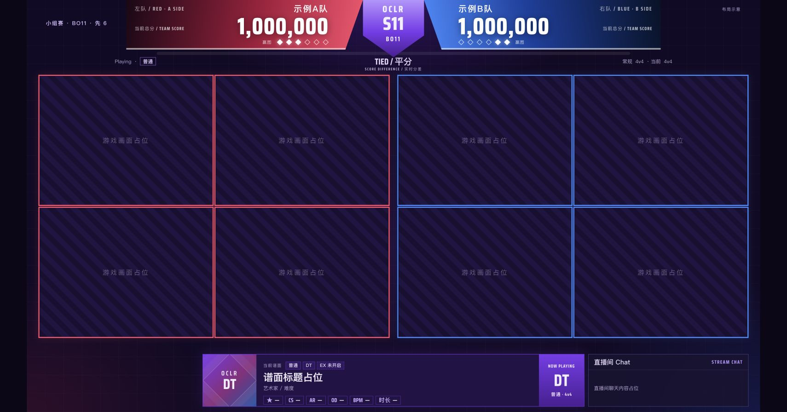

# OCLR 直播 Overlay

OCLR 赛事直播项目，前端已迁移至 **Vue 3 + Vite + TypeScript**，按用户提供的 HTML 重构为 **Neon Broadcast** 深紫电竞视觉：红蓝斜切横幅、中央盾牌、大比分、模组横排图池与紧凑谱面卡。保留六场景、S11 本地演示交互、URL 恢复及 Playing / 单图结算共用窗口。数据基础层与画面仍分离，尚未接入真实数据，也未完成真实 tosu / osu! tourney / OBS 联调。

## 当前内容

后续开发路线见 [直播员控制台与浏览器播出方案](docs/design/operator-console-plan.md)：优先完成独立控制台、共享状态与“到场 → Roll → BP → Playing 循环 → Winner”流程。OBS 保持同一个浏览器源，由控制台直接驱动网页换画面，不切 OBS 场景或增加 OBS 确认步骤。该方案目前为设计提案。

| 路径 | 内容 |
| --- | --- |
| `server/` | 仅本机监听的 OCLR 只读 API 代理，凭证只留在服务端 |
| `src/` | OCLR API、tosu v2 WebSocket 与统一订阅入口 |
| `test/` | 数据边界、分页、断线与凭证隔离测试 |
| `ui/` | Vue 场景、共享窗口/谱面组件、TypeScript 状态与本地视觉资产；后续前端修改入口 |
| `dist/` | Vite 生成的生产资源，已忽略，不提交 |
| [`design/layout-v1/`](design/layout-v1/layout-plan.md) | 迁移前的 S11 视觉参考、布局决策及截图 |
| [`docs/verification/vue-migration/`](docs/verification/vue-migration/README.md) | Vue 迁移检查记录、布局比对与新版截图 |
| `ui/broadcast.css` | 当前深紫背景与直播视觉；本地字体位于 `ui/assets/fonts/` |
| [`design/layout-v1/s11-rules.md`](design/layout-v1/s11-rules.md) | S11 v1.6 规则映射、UI 边界及待定项 |

构建后，数据服务的 `/`、`/index.html`、`/overlay` 提供 Vue UI；`/api/health` 返回服务状态 JSON。默认画面仍使用明确标注的本地演示数据。

## 开发与生产运行

需要 Node.js 22.13+，本机已验证 Node.js 24.16。首次安装依赖并启动开发页：

```sh
npm ci
npm run dev
```

打开 <http://127.0.0.1:3003/>。Vite 仅监听本机，根目录限制为 `ui/`，不加载 `.env.local`。开发页只做 UI 演示，不自动请求 OCLR 或连接 tosu。

生产构建与本机运行：

```sh
npm run build
npm start
```

打开 <http://localhost:3001/>；OBS 可使用 <http://localhost:3001/overlay#scene=playing&clean=1>，画幅设为 1920×1080。正式播出仍需真实客户端和 OBS 联调。`npm run preview` 可单独在 3003 端口查看构建产物，与开发服务择一运行。

`npm run check` 执行 Vue/TypeScript 类型检查，`npm test` 执行数据层、UI 状态及静态服务隔离测试。未构建时访问本机 UI 会返回 `UI_BUILD_REQUIRED`，先执行 `npm run build`。

## 当前视觉预览

打开 <http://127.0.0.1:3003/#scene=playing&clean=1&lead=left-small> 查看 Gameplay；按 `1`–`6` 切换等待、图池、Playing、单图结算、全场胜利、暂停。按 `C` 进入干净输出，`Esc` 恢复外部演示控件。

- 样式直接以用户提供的 `osu! 組隊賽直播界面.html` 为主：深紫细网格、红蓝斜切横幅、中央赛事盾牌、白色大比分、菱形赢图位和模组横排卡片。
- 融合 S11 的 BO11/BO13、6/7 赢图位、双方各两个 Ban 槽、EX 剩余次数与开启方、TB 禁 EX/不可 Ban、FM 提示及战术/技术暂停。参考稿的 BO9、示例队伍和结果不作为比赛数据。
- 常规 3v3/4v4 仍待最终确认；EX 对双方各减一人，3v3→2v2、4v4→3v3。Playing 与单图结算共用同位同尺寸游戏窗口，按 4:3 / 16:9 contain，不显示窗底姓名/角色栏。
- 顶部显示本图队伍分数；分差条以固定中线向领先侧延伸，数字位于外端。结算总分按有效人数求和，独立于 Playing 演示领先状态。
- 当前 NM/HD/HR/DT/FM/TB 六类的 20 个谱面条目、队伍、选手和分数均为本地演示；模组分布不是正式图池。未知参数/星数/胜者保持未知，不借用其他赛季数据。
- 字体、图形与背景全部本地提供；低强度背景光动画支持减少动态偏好。画布外规则演示抽屉默认收起。



本轮六场景截图与验证见 [Neon Broadcast 验收](docs/verification/neon-broadcast/README.md)，设计与规则边界见 [DESIGN.md](DESIGN.md)。旧版布局与浅紫截图保留在 `design/layout-v1/`、`docs/verification/vue-migration/` 和 `docs/verification/team-colors/`，仅作历史对照；后续视觉修改以 `ui/` 为准。

## 数据来源

| 来源 | 用途 | 入口 |
| --- | --- | --- |
| tosu | 游戏状态、当前谱面、单人/Showcase 成绩、赛事客户端、实时队分、星数、聊天 | `ws://127.0.0.1:24050/websocket/v2` |
| OCLR 网站 | 已发布赛季、队伍/队员、赛程、正式结果、图池、晋级结构 | `https://oclr.org/api/v1` |
| 直播员选择 | 当前赛季、场次、图池、左右队伍、重复谱面槽位 | `BroadcastData.selectEdition/selectMatch`，仅在内存中 |

不生成或维护 `bracket.json`，不连接数据库。实时星数和游戏成绩与 API 中的正式结果分别保存；不因名字相同而自动绑定队伍。不从其他赛季借用空缺资料，也不从比赛结束事件自动写入正式结果。API 的 `/bracket` 仍可读取，它是线上晋级结构资源。

## 运行数据服务

需要 Node.js 22.13+（本机验证使用 24.16）。Node 代理本身使用标准库；Vue 页面需要先安装依赖并构建，见上文。

```sh
# 在项目根目录运行
cp .env.example .env.local # 仅初次配置；已有文件不要覆盖
npm start
```

服务地址为 `http://localhost:3001`，仅监听 `127.0.0.1`，与现有 `3000` 网站分开。

`.env.example` 默认以匿名模式读取 `https://oclr.org`。需要 Bearer 认证时，在不提交 Git 的 `.env.local` 中设置 `OCLR_AUTH_MODE=bearer`，并填写 `OCLR_API_KEY` 或将 `OCLR_CREDENTIALS_FILE` 指向已有的服务端凭证文件；相对路径以项目根目录解析。前端不接收 Key。仓库不包含任何本机 `.env.local` 或凭证文件，克隆后需自行配置。

`OCLR_API_ORIGIN` 必须与 Key 获发时绑定的 Origin 一致，由服务端发送，与本服务端口独立配置。Key 失效时返回 401/403，停止自动刷新并清空赛事快照。更新凭证后重启服务，再调用 `refresh()`。不会自动降级匿名。若明确使用公开匿名数据，将 `OCLR_AUTH_MODE` 设为 `anonymous` 后重启。

`.env.local` 和凭证文件绝不能通过静态 HTTP 服务器公开。本项目的 Node 服务只公开构建入口、显式允许的构建资源、四个指定浏览器数据模块和只读 API；不会公开项目根目录或未知路径。不要对整个工作区或项目使用 `python -m http.server`。

## 给后续 UI 的入口

Vue 页面现已由本项目本地服务同源提供，仍未订阅真实数据。`ui/model.ts` 仅表达本地演示状态；后续通过独立 composable 订阅 `src/index.js`，明确处理来源/缺失/过期/错误，不用演示值填补真实数据空缺。API Key 继续只留在服务端。

```js
import { createBroadcastData } from '/src/index.js';

const data = await createBroadcastData();
const unsubscribe = data.subscribe(state => {
  // state.oclr: status / updatedAt / error / data
  // state.tosu: status / updatedAt / data
  // state.selection: 当前赛季、场次、图池、左右队伍 ID
  // state.currentPoolEntry: 唯一匹配的谱面槽位，或 null
  // UI 按 status 决定是否显示内容，禁止把旧快照当作 live。
});

await data.selectEdition('s11');
// 从已取得的数据中选择真实 ID；空列表时保留未选择状态。
// data.selectMatch({ fixtureId, poolId, leftTeamId, rightTeamId, entryId });
data.start();

// 页面/场景销毁时：
// unsubscribe();
// data.stop();
```

独立的 `OclrClient.tournaments()` 可用于赛季选择器，`edition(slug)` 读取赛季资料。服务器也允许读取单场 `/api/oclr/tournaments/{edition}/matches/{uuid}`；历史归档的场次键可能不是 UUID，应保留 `/bracket` 数据，不能猜成当前赛事 fixture ID。

赛事快照按顺序读取 overview、teams、competition、mappools、bracket 和完整 players，每 60 秒刷新（可配置，最低 30 秒）。这些跨资源读取**不是数据库原子快照**，`updatedAt` 只是本地成功读取时间；正式来源时间/版本仍以各资源内容为准。分页集合带版本，409 后整份重读一次；不会返回半份名单。429 遵守 `Retry-After`。失败状态与真实空集合分开。

tosu 默认 5 秒无有效帧标记 stale 并重连，断线每秒重试；`stop()` 取消重连。每个新帧替换旧客户端列表，避免上一场选手残留。缺失数字保留 null，真实 0 保留 0。不在此阶段自动判定胜负、实现 Ban/Pick 规则或做动画。

## 参考与验收

- 官方 tosu：[项目与端点](https://github.com/tosuapp/tosu)、[v2 字段示例](https://github.com/tosuapp/tosu/wiki/v2-websocket-api-response)。公开文档对赛事数据标注了尚待测试，本机还需真实 tosu/赛事客户端验收。
- OCLR：[组织](https://github.com/OCLR-dev)、[机器可读接口](https://oclr.org/api/v1/openapi.json)。本次已实际读取线上 1.1.0 合同。
- MP5 参考项目仅用于核对 `/ws`、`COMMON/lib/bracket.js` 和比赛/Showcase 页面；该参考项目与其二进制、图片和字体均未收入仓库。
- OWC 2019 参考录像与截图位置见[布局规划的参考来源](design/layout-v1/layout-plan.md)。参考截图用于说明空间关系，不是 OCLR 的赛事素材或示例赛果。
- 本项目暂未提供自己的 Swagger UI；OCLR 上游的 OpenAPI 地址见上述链接。

```sh
npm test
```

测试覆盖分页重读/完整性、权限错误、缺失值/零值、谱面重复槽位、跨赛季竞态、断线重连、Key 隔离和代理边界。

2026-10-26 通过新项目本地代理的线上读取：9 个赛季（S3–S11）；S11 公开 players 为 32 人，teams、mappools、fixtures 均为 0，bracket 为 null。已验证代理不公开凭证文件。13 项自动测试通过。空值只是本次读取状态；联调服务已关闭，使用时运行 `npm start`。

Vue 版本已完成 1920×1080 六场景浏览器视觉复核及八组窗口几何对照，18 项测试通过。覆盖 S11 阶段/BO/星位、常规 3v3/4v4、EX/TB、Ban 槽校验、暂停和快捷键。截图与验收边界见[迁移记录](docs/verification/vue-migration/README.md)。减少动态偏好的 CSS 关闭路径已保留，系统偏好切换尚未实测。真实 tosu、osu! tourney 和 OBS 尚未联调，这些检查不等于实际播出验收。

S11 规则来源为 <https://oclr.org/tournaments/s11#rules>（1.6，核对日期 2026-10-26 America/New_York）。EX 窗口映射按用户 2026-10-27 America/New_York 的确认实现；常规人数最终仍待定，正式图池、报名结束前变化和真实阵容/数据接入仍待后续。本仓库不据此写正式结果或冠军。
