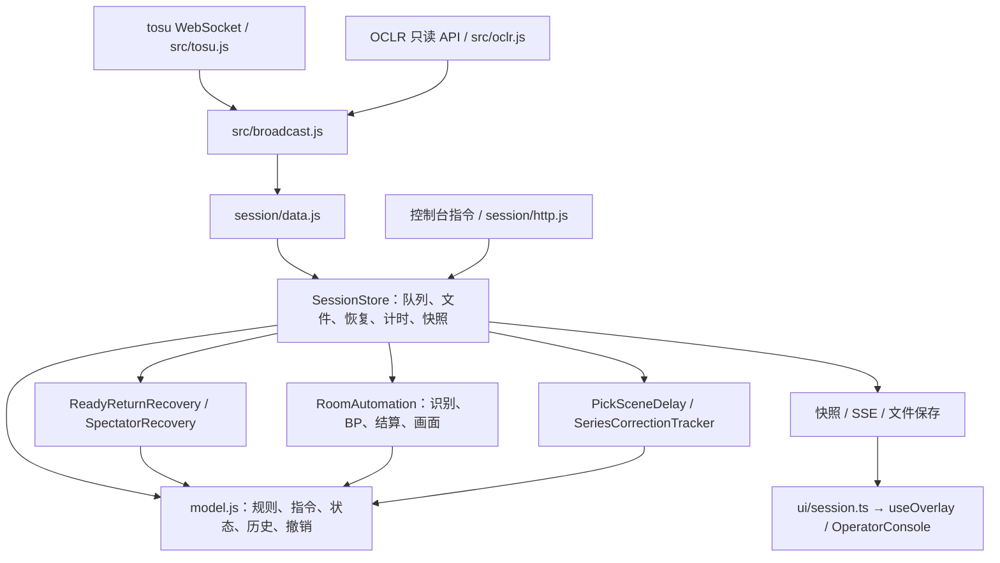
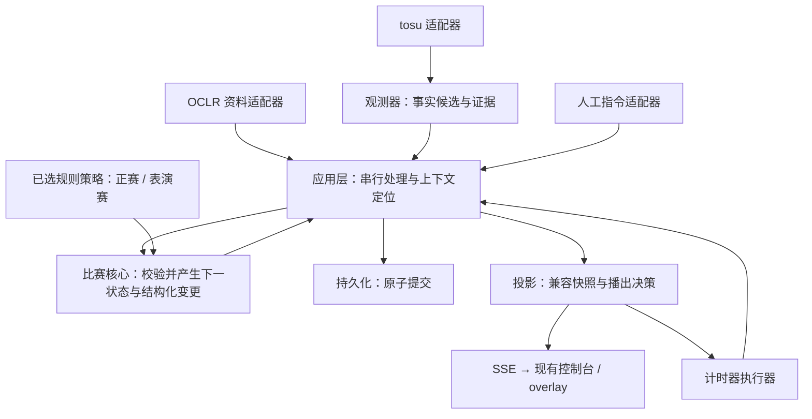
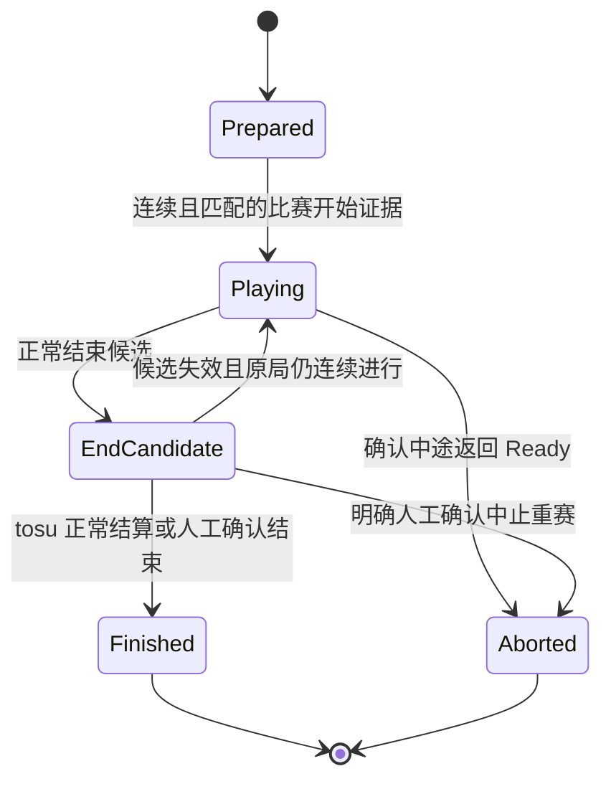

# 自动化状态机重构设计草案

日期：2026-11-08（America/New_York）。调查基线：本地 `main`，`9c64d1d`。

本文交付现状依赖图、目标职责与扩展契约、状态转换表和验收场景。状态为**设计草案，尚未实现**。本轮只新增本文，不修改比赛数据、运行服务或自动化代码。

## 1. 范围与决策来源

本次重构针对服务端自动化流程、状态机及必要的人工处理指令。控制台的布局、交互和易用性由用户后续另行重构；本轮仅规划现有入口怎样接入明确指令。

主分支支持 OCLR 正赛与 OCLR 表演赛。通用赛事工具可在其他分支发展，不在主分支增加任意赛事配置器、动态插件系统或新规则。

### 本轮讨论已确认

| 事项 | 确认的行为 |
| --- | --- |
| 操作目标 | 选好本场后自动跟随房间；热手进入／退出、Roll、EX、异常处理、TB 准备与收尾保留明确人工操作 |
| 热手 | 仅影响直播端的显示状态，进入与退出均由直播员手动控制；通常在 Roll 前、双方各选池外图是现场习惯，不作为自动识别条件 |
| Roll | 沿用现有规则；直播员根据房间 Chat 手动录入点数和先手，不新增 Chat 自动解析 |
| 正赛 BP | Roll 后进行 Ban／Pick，包含前后两轮 Ban |
| 表演赛 BP | 默认 Roll 决定先 Pick，双方交替 Pick，不自动加入 Ban |
| 自动确认选图 | 房间切到本场图池内的谱面时，按当时明确的行动方与 Ban／Pick 动作处理 |
| 错图 | 裁判换错图或队伍报错 Slot 时，由直播员介入，不自动推断纠错意图 |
| 逆流程 | 支持撤回本次 Ban／Pick；已发生后续操作时，可直接修正 Mappool 标记，不连带处理另一队或重排流程 |
| 开始后改谱面 | 属于后续控制台专题，本轮不扩大其功能，也不让标记修改改变正在播出的比赛 |
| EX | 队伍向裁判宣告，直播员手动开启；表演赛没有 EX |
| EX 消耗 | 该 Pick 开启 EX 且本图正常产生胜负后消耗；开启、准备、进入 Playing 均不消耗 |
| 同图重赛 | 保留 Pick 与已开启的 EX；回到等待比赛开始，重赛正常结束后总共只消耗一次 EX |
| 改胜方 | 保留 EX 消耗 |
| 中途 abort | 未正常结束的本次比赛中止，回到原 Pick 的 Ready，再次 Playing 时建立新的比赛记录；被中止记录不判胜 |
| 正常结算 | 以 tosu 本次比赛的正常结算分数自动确认胜负，不增加人工确认步骤；分数或胜负有误时由直播员修正。Playing 保留最终队分，房间返回准备时自动回图池 |
| 迟到赛果 | 上一图待人工确认不阻止下一项 BP；人工补记必须定位具体旧图，不干扰新图 |
| TB | 到达决胜比分后由直播员明确准备，不把下一普通 Pick 或房间换图当成自动进入 TB 的指令 |
| 整场收尾 | 达到整场结束条件后停止普通 BP；胜方画面由直播员主动展示 |
| 平分 | 用户明确暂不展开；不在本轮新增专用自动化分支或扩大处理范围 |
| 用语 | 使用“等待比赛开始”“本局进行中”“本局结束”“比赛中止”“等待重新开始”；内部一次 Ready → Playing 对应一份单次比赛记录 |

### 保留的兼容基线

以下来自现有项目合同与代码，不冒充本轮重新逐项确认的赛事规则：

- 正赛现有顺序为双方 Ban 1 → 双方各 Pick 并比赛 → 双方 Ban 2 → 继续交替 Pick；先 Ban、先 Pick 分别记录。BO、人数、Ban 限制沿用已有规则，本文不重新定义官方赛制。
- 表演赛的先胜／固定图数等结束条件来自已导入的 OCLR 资料；不套用正赛的目标或 TB 门槛。既有明确人工配置仍保留。
- 中途加入和初始化后可直接显示有效 Playing、谱面和实时队分；到场、Roll、图池及完整 BP 不是实时显示前置条件，未知历史不补造。
- 自动 BP、自动画面、自动计胜的开启意图独立保存；临时条件不足不改成关闭。明确暂停仍是人工指令，不新增全局人工接管状态。
- OBS 沿用同一 `/overlay` 浏览器源；服务端唯一推进比赛，浏览器只发指令、订阅与渲染。
- 赛事 API 保持只读，凭证只在服务端；历史完整图池标明赛季与验证用途，不回填当前赛事或赛果。

## 2. 当前依赖与耦合

### 现有调用链



### 已从源码确认的结构问题

| 当前位置 | 事实 | 重构需要处理的边界 |
| --- | --- | --- |
| `model.js` | `applyCommand` 集中处理 BP、局次、赛果、画面、暂停与资料；正赛／表演赛判断分布于多个函数 | 规则差异与通用状态校验分别拥有明确职责 |
| `automation.js` | 同一观察器识别换图、开始、Ranking，又直接调用比赛变更及修改 `scene` | 观测结果、比赛决策、播出决策之间建立单向接口 |
| `store.js` | 保存队列之外还决定恢复顺序、业务计时及各观察器何时 reset／rebase，并直接清理观察器内部字段 | 应用层编排与基础设施分开；生命周期通过接口处理 |
| 三个转换入口 | 人工使用 `transition`，自动与恢复使用允许任意回调修改草稿的 `automaticTransition` | 两类来源共用受校验的比赛操作，不允许策略任意写共享状态 |
| 当前图定位 | `rounds` 已能保存多局，但自动结算资格及多个恢复观察器主要围绕 `currentRoundId` 保存 | 当前比赛指针不能作为迟到事件或人工补记的归属依据 |
| `applyBp` | 准备阶段再次换图可以进入 `replace-pick` 路径 | 区分正常动作确认、显式修改 Pick、人工标记修正；不能从第二次换图擅自推断纠错 |
| EX | `startRound` 保存 `exTeam`；`ex.remaining` 由人工命令设置，`awardTosuResult` 没有自动消耗 EX | 本轮目标包含新增与赛果关联的消耗语义，迁移时不能追扣历史 |
| 热手 | `RoomAutomation.ingest` 在 `state.warmup` 时 reset 并提前返回；比赛命令也有热手守卫，退出还检查房间是否返回准备状态 | 当前实现耦合了直播显示与正式比赛流程；目标按本轮修正，将热手开关归入播出状态，不再作为比赛核心的流程开关 |
| 计胜判断 | Ranking、队分稳定及逐人求和一致用于自动计胜；归一化后的选手数据未提供已验证的逐人完成证据 | 保留本次比赛正常结算的自动确认路径及人工修正能力；现有时序局限列入技术记录，不增设全员完成证明作为实施或正常流程的门槛 |
| 播出语义 | `phase`、`scene` 和比赛记录在多个分支一起写；`autoWinAward.ts` 还从历史消息文字提取自动计胜信息 | 使用明确状态和结构化变更，不让日志文案决定业务或动画语义 |

已有恢复模块、串行队列、命令 ID、版本校验、原子文件替换、只读输出可以保留。上述结构事实不等于每一项现场故障的唯一根因。

源码入口：[model](../../server/session/model.js)、[automation](../../server/session/automation.js)、[store](../../server/session/store.js)、[data](../../server/session/data.js)、[tosu](../../src/tosu.js)、[自动计胜展示](../../ui/autoWinAward.ts)。

## 3. 目标职责与依赖方向

下面是逻辑模块建议，目录与文件名在实施切片时确定。沿用当前工具链，不为本次设计引入状态机框架或消息中间件。



图中 `核心 → 应用层` 表示返回值，不表示核心导入应用层；`投影 → 计时器` 表示申请带身份的展示期限，不表示计时器可以写比赛记录。

| 模块 | 拥有的职责 | 不拥有的职责 |
| --- | --- | --- |
| 来源适配器 | 解析来源、记录接收序号／连接代次／新鲜度、保留缺失值 | 推进 BP、判断胜者、切画面 |
| 观测器 | 针对房间与单次比赛识别稳定换图、开始边沿、结束候选、返回准备及观测恢复，输出证据 | 扣 EX、决定重赛、任意修改会话 |
| 应用层 | 定位目标、串行处理、注入时钟与 ID、协调操作顺序、提交及通知 | 根据某个策略的内部字段补丁式 reset |
| 比赛核心 | 维护明确对象关系，校验人工／自动操作、执行合法转换、输出结构化变更 | 网络、文件、定时器、浏览器、读取原始 tosu 字段 |
| 规则策略 | 正赛／表演赛的 BP 计划、可用性、结束条件、TB／EX 资格 | 修改比赛记录、保存文件、选择播出画面 |
| 赛果及消耗计算 | 根据有效赛果计算系列分、该 Pick 的 EX 消耗及人工校正，保证贡献唯一 | 根据稳定时长自行证明所有选手结束 |
| 投影与播出决策 | 管理手动热手显示状态，生成图池显示、实时信息与场景请求，适配当前快照接口 | 修改实际 Pick、比赛记录或赛果 |
| 基础设施 | 文件保存、HTTP／SSE、时钟调度、旧数据迁移 | 嵌入正赛／表演赛分支或决定业务恢复 |

人工处理与自动化请求最终调用相同的比赛操作，但输入依据不同：人工可以明确确认胜方；自动确认使用身份匹配、本次比赛连续性有效的 tosu 正常结算分数。保留来源新鲜度、缺失分数、重复事件及人工结果保护的基础校验，不增加超出现有来源能力的完成证明要求。

## 4. 开闭原则如何落地

### 有限、明确的扩展点

- **赛事规则策略**：根据明确的赛事类型在入口装配。正赛与表演赛实现同一组只读决策接口，返回 BP 动作、资格与结束判断。核心不散布 `if exhibition`；新增类型必须显式注册，不能从队名猜测。
- **观测及恢复策略**：输入统一的房间事实与只读上下文，输出带目标和证据的识别结果／处理请求。每项策略声明适用范围、证据有效期及何时失效，不接收任意状态修改回调。
- **播出策略**：消费已提交的结构化变更，产生场景请求与展示期限。修改 Pick 展示时长不修改 BP 或赛果代码。

接口形式示意（非已实现 API）：

```text
rule.plan(context) -> 明确的待执行 BP 动作
rule.validate(operation, context) -> 允许 / 拒绝及原因
rule.completion(context) -> 进行中 / 等待核对 / 已结束
observer.observe(frame, context, evidence) -> observations + nextEvidence
domain.decide(state, operation, rule) -> nextState + changes
presentation.project(state, telemetry, changes) -> view + displayRequests
```

核心维护所有对象的引用完整性、合法状态转换、贡献去重及人工优先。扩展策略不能绕过这些约束。新增业务概念确实改变核心契约时，应明确升级契约；开闭原则不意味着核心永远不能修改。

### 扩展的审查标准

| 变化 | 预期主要改动 | 应保持稳定 |
| --- | --- | --- |
| 表演赛不经过 Ban | 表演赛规则与对应场景验证 | tosu 适配、比赛记录、文件层 |
| 一种已确认的观战恢复序列 | 对应观测／恢复策略 | BP 顺序、计胜与 EX 贡献算法 |
| Pick 展示时长变化 | 播出策略及期限调度 | 比赛开始身份、赛果 |
| 新增明确人工处理入口 | 指令适配及必要的领域操作 | 自动操作原有校验与去重 |

只把大文件拆成若干仍可任意互改字段的类，不满足本设计。

### 减少无意义的防御性代码

用户补充要求：减少没有实际业务依据的防御性代码。实现以明确契约和单一责任为基础，不用层层兜底掩盖职责或状态设计问题。

- **边界统一校验**：外部 tosu／OCLR 数据、人工指令和持久化文件在各自入口校验、归一化。内部模块使用已成立的契约，不重复解析或逐层检查同一字段。
- **按状态表达必需数据**：某状态必需的对象通过状态模型或明确接口提供；不在每个内部函数重复判空，不用可选链和默认空对象把缺失的必需数据伪装成合法状态。真实缺失的来源值继续明确表示未知。
- **不变量问题直接暴露**：内部违反契约时在责任位置报告明确错误，不添加“失败就跳过”“猜一个默认值”“重新初始化整场”等无业务依据的恢复路径。
- **异常按职责处理**：只在有实际恢复或报告责任的位置捕获异常，不层层 `try/catch`，不吞掉异常后返回成功，也不为理论上可能发生的情况不断增加分支。
- **兼容集中在迁移入口**：旧字段和旧 schema 的兼容在适配／迁移处完成，不把历史兼容判断散布到规则、状态转换和展示逻辑。
- **保留有明确用途的守卫**：状态转换是否合法、事件是否属于本次比赛、重复请求、异步版本冲突及保存失败是已有实际风险，集中在拥有该职责的位置处理，避免调用链重复校验。

审查每个新增防御分支时，应能指出具体外部输入、异步交错或业务条件；仅以“保险起见”为理由的分支不保留。本要求不新增独立测试清单，按受影响的关键行为验证。

## 5. 对象身份与局部状态机

### 身份及拥有关系

| 对象 | 身份与关联 | 生命周期 |
| --- | --- | --- |
| 本场比赛 | `matchId`、规则类型及规则版本 | 资料导入／初始化建立；与文件格式版本分开 |
| BP 动作 | `actionId`、行动方、类型、顺序位置 | 待执行 → 已确认；指定动作可撤回，修订留历史 |
| 本次选图 | `selectionId`、来源动作或明确人工选择、图池条目、Pick 方／TB、EX 设置 | 跨同图重赛保持身份；换新 Pick 才建立新对象 |
| 单次比赛记录 | `attemptId`、`selectionId`、房间与谱面身份 | 等待开始 → 进行中 → 正常结束候选／中止；重赛建立新记录 |
| 赛果 | `resultId`、`attemptId`、当前修订、来源、确认依据 | 未确认 → 已确认；可修正或撤回，旧自动信号受保护 |
| 观测证据 | 连接代次、接收序号、目标身份、接收时间 | 临时有效，重启不恢复“有权计胜”的证据 |
| 播出状态 | 当前场景、热手显示、人工画面选择 | 热手由直播员明确进入／退出，房间信号不自动切换其开关；不参与比赛核心的状态守卫 |
| 展示期限 | 本场及选图身份、触发变更 ID、期限 token | 到期后重新校验；旧期限不能影响新图 |

`currentSelectionId` 只定位当前准备／比赛对象，不能作为旧事件的缺省目标。待确认赛果按 `attemptId` 保存为集合，可同时存在旧图待核对与新图进行中。

接收序号用于去重和排序本连接收到的数据，不能证明上游帧内容是新成绩。这是技术局限；正常路径仍按 tosu 结算自动确认，出现误判时保留人工修正。

本场使用明确的规则版本；资料周期刷新不重新选择规则、不重排已执行 BP。规则或赛制修正通过显式指令校验已有记录，不能随配置更新静默改变。

### 单次比赛记录



对应中文：`Prepared` 等待比赛开始，`Playing` 本局进行中，`EndCandidate` 结束候选，`Finished` 本局正常结束，`Aborted` 比赛中止。候选用于过滤短暂状态变化，不要求正常结算再经直播员批准；成绩缺失时允许比赛已结束、赛果仍待人工确认。

同图重赛通过原 `selectionId` 建立另一份 `Prepared` 记录；旧记录不回到进行中。一次明确重赛指令可以同时终止旧记录、撤回其贡献并建立新记录，原操作历史保留。

观测状态独立使用正常、证据不足／中断、重新建立观察位置。连接断线或窗口缺失不把比赛记录改成 `Aborted`。不新增覆盖所有功能的“异常中”状态。

## 6. 状态转换与影响范围

| 当前情况 | 输入及守卫条件 | 状态／数据变化 | 保留内容或受限范围 |
| --- | --- | --- | --- |
| 当前明确 Ban／Pick | 新换图稳定、房间匹配、池内唯一条目、动作身份及修订仍一致、条目合法 | 确认一次当前动作；Ban 开放下一动作，Pick 建立本次选图及等待开始记录 | 重复帧不重复确认；修改过动作后旧候选失效 |
| 无明确动作／重复谱面 ID 槽位 | 房间换图但归属不明确 | 只更新实时房间信息，保留待人工选择提示 | 不猜行动方、槽位或 BP 历史 |
| Pick 已确认、尚未开始 | 再次换到另一条目 | 记录新的房间观测，等待明确修正 | 不自动替换旧 Pick，也不当成下一队 Pick；实时显示仍可跟随 |
| 人工撤回本次动作 | 指定动作，尚无阻止局部撤回的依赖 | 撤回该动作贡献并恢复对应待执行步骤 | 不回滚整场快照；后续记录存在时不自动级联删除 |
| 人工修改 Mappool 标记 | 指定谱面与标记 | 仅更新播出标记修订 | 不改另一队、真实比赛记录、比分及 BP 游标；实际 Ban 记录修正为另一种明确操作 |
| 等待比赛开始 | 同图同房间，存在有效 Ready → Playing 连续证据，满足对应开始资格 | 建立该次比赛身份，进入进行中，记录本次 EX 上下文 | 不扣 EX；首次接入已在 Playing 时只显示，不补造开始 |
| 本局进行中 | 同上下文连续直接返回 Ready，未出现尚待辨认的结束候选 | 原记录中止，为同一 Pick 建立准备记录 | 保留 Pick、EX、系列分；旧记录失去自动计胜资格 |
| 本局进行中 | 断线、窗口缺失、无效帧、换房间或数据过期 | 相应证据失效，限制该记录的自动结算 | 不宣布选手掉线／abort；有效实时信息独立展示 |
| 本局进行中 | 同次比赛出现 Ranking | 建立结束候选，按现有正常结算条件处理 | 短暂状态变化按原有防抖处理，不新增额外全员完成证明或人工批准 |
| 结束候选 | 连续 Playing 恢复且可证明仍为原次比赛 | 撤销候选，继续原记录 | 无比分／EX 副作用；不建立假重赛 |
| 结束候选 | tosu 正常结算，本次比赛队分齐全有效 | 自动确认本次比赛结束及胜负，计算系列分与 EX 消耗；释放后续 BP 一次 | 不增加人工确认步骤；结果有误由直播员修正 |
| 结束候选 | 已结束但成绩不足，或直播员明确确认本图已结束 | 建立该记录的待核对赛果；释放后续 BP 一次 | 只等待该图赛果，下一 BP 可以继续 |
| 正常结束、赛果待核对 | 本次比赛仍可明确关联的 tosu 结算分数补齐，且未被人工保护 | 自动确认赛果，计算系列分及 EX 消耗一次 | 无法关联时留给人工，不从当前新图取值；不再次释放 BP |
| 旧图赛果待核对 | 直播员明确指定旧图胜方 | 确认指定赛果与相应 EX 消耗 | 保留新图、当前 BP、当前画面与无关观测 |
| 已确认赛果 | 人工修改胜方 | 调整胜方贡献，保持 EX 消耗 | 人工结果不被旧帧覆盖 |
| 同图需要重赛 | 明确指令或已核实的中途返回准备事件 | 原尝试终止／被替代，撤回其赛果与 EX 贡献，同 Pick 建立新准备记录 | 独立系列比分校正不自动抹除；已有后续实际比赛时禁止静默改写其顺序 |
| 决胜比分 | 直播员明确准备本场合法 TB | 独立准备 TB，无普通 Pick 方，禁 EX | 不消费普通 Pick 队列；房间直接换 TB 不代替人工指令 |
| 达到整场结束条件 | 有效赛果或人工校正造成结束条件成立 | 停止新增普通 BP，等待收尾 | 已观察到的新图／待处理记录保留；不自动切 Winner |
| 整场已结束 | 直播员主动展示胜方 | 更新播出状态 | 不重复记胜；改分后按规则重新计算结束资格 |
| 热手显示未开启 | 直播员明确进入热手 | 开启直播端热手显示状态 | 不改变 BP、比赛记录、赛果、EX 或观测连续性，不产生比赛事件 |
| 热手显示已开启 | 直播员明确退出热手 | 关闭直播端热手显示状态 | 不要求房间先返回 Ready，不自动补执行进入／退出期间的比赛事件 |
| Pick 展示期限到达 | token 仍对应本场、本次 Pick 和有效显示意图 | 仅执行对应场景切换 | 不把等待准备改成比赛已开始 |

正常 tosu 结算按自动流程执行。无法判断的中间状态只保留该图的人工处理入口，不升级为整场暂停、不扩大自动推断范围。人工可以确认本图结束而暂不指定胜方，让场内下一 BP 继续，之后补记或修正指定图的结果。

热手属于播出状态，不是比赛阶段或观测异常状态。进入／退出只改变显示设置，不暂停比赛自动化、不清空观察器、不新增或撤回正式记录；房间信号继续按原有身份和规则独立处理。池外图不自动开启热手，Ready／Playing／Ranking 也不自动退出热手。暂停保留现有明确操作语义，不在本轮新增处罚或自动暂停规则。

## 7. 指令、证据与提交契约

### 目标明确、贡献唯一

人工和自动请求共同携带操作 ID、本场 ID、预期版本，以及相关 `actionId`／`selectionId`／`attemptId`。本次比赛已被中止或替代时，旧成绩不得转交给新记录；同一图谱面 ID 不能替代单次比赛身份。

建议的领域操作包括确认 BP、撤回指定 BP、显式修改未开始的 Pick、修正图池标记、开启／关闭 EX、确认比赛开始、确认中止并重新准备、确认正常结束、确认／修正指定赛果、同图重赛、校正系列比分、准备 TB、切换画面和展示胜方。名称不是新 HTTP 接口承诺；由现有命令适配器逐项映射。

事实、请求、已提交变更分开命名：观测到 Ranking 是候选事实；申请确认胜方是请求；`ResultConfirmed` 才是通过校验后可用于计算贡献的变更。

### 正常结算与人工纠错

业务决策已确认：按 tosu 正常结算分数直接自动确认本图胜负；发生分数计算或判胜错误时，由直播员修正指定图的胜方。正常路径不等待额外人工确认，也不增加全员完成证明或额外固定等待。

保留来源及房间有效、已观察到本次比赛开始、分数可关联到本次比赛、基础数值完整性、赛制资格及人工优先校验。首次接入的旧 Ranking、中止记录、已替代记录或其他图的分数，不能用来确认当前图；缺失分数不能当作 0。

现有 `early-ipc`／`coherent-stale` 探测揭示的是上游时序与快照新鲜度的技术局限，保留调查记录，不声称架构重构已证明所有选手完成，也不把解决该局限列为本次重构或正常自动计胜的前置条件。异常只影响关联记录，提供人工确认、改胜方、同图重赛和 EX 校正；人工处理后旧帧不能重新覆盖结果。

### EX 与比分

- 正常赛果的赢图贡献以有效赛果身份唯一计算；EX 消耗以本次 Pick 身份唯一计算。重复帧、重复确认及人工改胜方不重复贡献。
- 同图重赛撤回原尝试的贡献，但保留该 Pick 的 EX 开启设置；新赛果确认后消耗一次。
- EX 开关、赛果确认、系列比分校正分别是不同操作。独立校正值保留来源，不从校正差额猜哪张图使用过 EX。
- 旧会话中的 EX 剩余次数可能已被人工扣除。迁移以保存值作为基线，不遍历旧赛果追扣，原记录没有的 EX 消耗历史保持未知。
- 只校正系列比分但未明确单图赛果时，不能据此新增该图 EX 消耗；需要另外明确赛果或人工校正 EX，不能推断。
- 撤回赛果但尚未决定重赛等中间状态交由直播员处理，保留当前记录及 EX 人工校正入口，不新增自动推导最终消耗的分支。明确改胜方及明确重赛继续按已确认规则执行，人工校正后的值不被旧事件重复扣减。

### 串行、原子与副作用

应用层使用同一串行队列处理人工命令、观测结果和期限到达事件。核心计算下一状态及结构化变更；保存成功后发布快照并执行展示请求。保存失败不发布已应用的比赛结果。

沿用命令去重、版本冲突检查和原子文件替换。运行时单次去重与持久化操作去重分别处理，重连不重放计胜。核心的时钟和 ID 由调用方提供，使同样输入可用于离线重放。

不要求全面事件溯源：快照继续作为持久化基础，结构化变更用于审计、去重和投影。日志中文措辞变化不应改变自动化结果。

恢复接口按房间、动作、选图、单次比赛及赛果范围失效证据；不允许通过访问其他观察器的 `pending`、`endRun` 等内部字段完成恢复。计时器带目标身份及 token，超时只是重新校验请求。

## 8. 实施切片与兼容

1. **固化行为边界**：优先复用受影响的现有回归，只在关键行为缺少覆盖时补场景，不把状态表逐行翻译成新测试。新增 EX 自动消耗、显式错图纠正及热手与比赛流程解耦属于目标变化，不伪装成等价搬迁。
2. **引入明确身份与兼容投影**：建立 Pick 与单次比赛的区别、待核对赛果集合；通过适配保持现有 HTTP／SSE、`Round` 字段和控制台可用。保存新旧身份映射，避免直接改变旧 ID 的含义。
3. **提取赛事规则**：迁出正赛／表演赛 BP、结束条件及 TB／EX 资格。入口静态装配，两类规则都走相同比赛操作。
4. **收束状态写入**：逐项将自动与人工操作迁入统一核心，加入赛果及 EX 唯一贡献。保留独立系列比分校正和人工结果保护。
5. **分离观测与恢复**：原自动化及恢复模块改为提供识别结果，生命周期失效显式化；处理旧图待核对、新图进行中及中止重赛的交错。
6. **分离播出与基础设施**：场景、延迟、计胜提示通过投影适配现有界面；Store 保留队列、提交与订阅，移走业务判断。

每个切片只有一个权威写入者，不让新旧自动化同时修改同一场比赛。需要对照时在隔离会话离线重放相同输入，比较状态与贡献；预期变化单独列出，不把相同输出当成唯一正确性标准。

旧文件迁移前保留原件，显式升级 schema，校验引用及人工校正，保留未知值；失败时拒绝覆盖。历史撤销保存域一并考虑。定向 BP 撤回不是整场快照恢复，现有全局撤销在迁移期间保持兼容，但不能代替新领域操作。

旧 `round.id` 保留为兼容引用；存在明确 `replayOf` 链时，才把关联记录映射到同一 `selectionId`，原记录分别映射为单次比赛记录。引用缺失或链有歧义时保留原数据并停止对应自动推断，不凭相同 beatmap ID 合并不同 Pick。迁移不创建未观察到的开始边沿、结束证据或历史 EX 消耗凭据。

已有后续 BP／比赛后再修改早先 Ban／Pick，由直播员根据现场直接修正目标标记或明确记录；系统不连带撤销另一队及后续操作。复杂中间状态提供人工处理，不新增自动级联回退或 EX 自动补偿链。

## 9. 验收场景与证据要求

测试数量以覆盖实际风险为依据，优先复用现有用例。只调整已改变行为的断言，不为新文件、内部函数、字段或每个状态组合各建一项测试；文案及低风险局部修改不新增测试。已有测试不为减少数量而删除。

下表是实施时按改动选择的验证方向，不是每批都要执行或逐项新增的测试清单。一个连贯场景可同时覆盖重赛、旧帧、计胜与 EX，避免分别搭建重复流程。

| 关键流程 | 必须成立的结果 | 优先复用的现有验证入口 |
| --- | --- | --- |
| 正赛／表演赛 BP 与收尾 | 各自顺序正确、一次动作只执行一次；TB 手动准备，结束停止普通 BP，Winner 人工展示 | `roll-bp`、`streaming`、`tiebreaker` |
| 中止、重赛、正常结算与 EX | 同 Pick 保留 EX；旧帧不结算新记录；最终计胜及 EX 各贡献一次；人工改胜方不重复扣减 | `ready-return`、`replay-rejoin`、`replay-score-contract`；只补 EX 联动缺口 |
| 人工纠错与旧图补记 | 修改目标不连带另一队；旧图补记不影响新图或重放 BP；人工结果不被旧帧覆盖 | `bp-corrections`、`series-correction-flow`、`automation-lifecycle` |
| 观测及播出相互独立 | 断线不等于中止，重新接入不补造赛果；手动热手只改显示，切画面不改比赛进度 | `spectator-recovery`、`live-playing`、`warmup`、`automation-lifecycle`；按实际迁移范围选择 |
| 身份迁移及原子提交 | 旧记录和人工校正保留、EX 不追扣；失败不部分记胜或扣减，重复请求不重放 | `session`、`session-http`；引入新 schema 时补代表性迁移样本 |

表中短名对应 `test/<短名>.test.js` 或 `.test.ts`，不代表本次已经执行通过。新增用例只断言业务结果和影响范围，不镜像实现内部结构；可在已有连贯场景中增加必要断言，避免另造重复测试。

每个切片只运行受影响的相关测试；仅在新增改动、失败或未解决问题需要时扩大或重复验证。规则提取阶段不运行无关的图像、动画或启动器验证，不重复截图与实录回放。类型检查和构建按实际触及的接口与代码执行，最终整合完成后做一次完整回归及构建；之后仅在继续改动或出现失败时重跑相关部分。

已有结算时序探测结果保留为技术记录；只有实际改动结算识别或相关恢复逻辑时才按需运行，不为扩大异常覆盖而新增对抗矩阵。若执行后仍报告既有风险，如实保留，不用普通测试通过覆盖它，也不把它扩展为正常流程的人工批准门槛。

真实 Windows／osu!tourney／tosu／OBS 的时序及播出效果单独验收；不以模拟通过代替实机结论。测试使用隔离会话与明确标识的样本，不初始化现有运行比赛、不重启直播服务。

## 10. 已确认的处理决策

1. **正常结算直接自动确认**：以 tosu 本次比赛正常结算分数判胜，计算错误或胜方错误由直播员介入修正指定图。不增加额外完成证明或人工批准门槛；来源校验、单次比赛身份、去重及人工结果保护继续保留。
2. **热手手动控制**：发生在正式比赛流程之前，仅影响直播端，直播员手动进入／退出；不需要自动识别，不参与比赛核心的状态守卫。
3. **中间状态人工处理**：撤回赛果、EX 消耗暂待核对等中间情况保留人工修正入口，不要求自动化推断最终决定，不作为全场自动化停滞的原因。
4. **不自动连带回退后续步骤**：例如红队 Ban HD2、蓝队随后 Ban HR1，之后发现红队选错，由直播员直接修正目标标记或明确记录；系统不因此撤销蓝队 Ban、重排后续 BP 或恢复整场旧快照。撤回本次 Ban／Pick 与直接修正历史标记保持不同操作。

以上已按用户反馈收束，不再列为等待用户决策的实施阻塞项。后续工作围绕这些契约进行状态机与模块重构，不新增平分策略、控制台重设计、通用赛事工具或自动裁判功能。

## 11. 参考依据

- [当前自由操作与中途加入合同](../main-operator-contract.md)
- [自动化生命周期及已知时序限制](../verification/automation-lifecycle/README.md)
- [结算时序对抗探测](../verification/result-timing/README.md)
- [MP5 回放修复及仍保留的证据限制](../verification/mp5-live-fixes/README.md)
- [表演赛 BP 首批修复](../verification/showmatch-issues-2026-11-08/FIXES.md)
- [当前本图异常方案](match-incidents.md)

本轮检查仅包含文档与源码读取、设计整理和文档校验，没有运行测试、模拟对局或实机验收。
