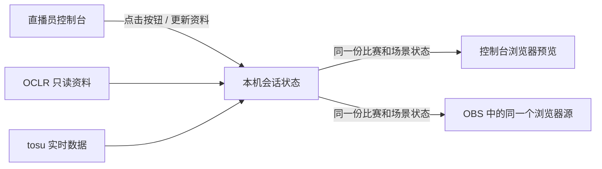

# 直播员控制台与浏览器播出方案 v9

日期：2026-10-28（America/New_York）。状态：控制台、独立只读输出、持久化共享会话、BP 自动跟随和开打/结算逻辑已实现，模拟验证通过，真实 tosu / OBS 联调待完成。

最新用户修订：tosu 正常结算应自动加赢图；异常必须允许直播员撤回计胜、改正胜方或直接输入正确系列比分。以下口径以本次修订为准。

## 使用者与易用性（2026-10-28 用户补充）

直播员是计算机基础可能较弱、临时帮忙的社区成员。控制台应让其按比赛现场完成直播，不把技术诊断、终端命令和状态机知识变成操作门槛。这是后续实现的优先约束，不能只通过增加帮助文案来满足。

开播前由组织者或维护者配置资料和已核实的 BP 顺序；比赛中主要使用一个控制台，突出当前对阵、比分、当前阶段、下一步与暂停/撤销。连接参数、来源详情、原始读数、模拟与日志留在设置或开发维护入口。

异常先给现场语言和少量可执行选择：

| 直播员看到的情况 | 普通操作路径 |
| --- | --- |
| 选完图还没开始，就卡住或取消启动 | 保留已选图，继续等待开打 |
| 有人卡住，其他人先结束了 | 先等一下，暂不加分；成绩确认后再继续 |
| 直播观战画面异常，比赛仍在继续 | 保留当前局，恢复画面后继续 |
| 裁判要求重赛 | 保留原选图，作废本次开打并准备重赛 |
| 胜方或系列比分记错 | 就近改正或撤销，清楚显示修改后的比分 |

上述路径使用选择项自动生成处理记录，补充说明可选；选择重赛仍需确认裁判决定，不能把技术恢复等同于重赛。系统无法辨明情况时，应说明“暂不计分，等待核对”并给出可操作入口，不要求直播员根据 IPC 数字作判断。

### 本轮已实现

- 正常流程自动跟随，细节人工控制用于防御意外，平时收起；不要把完整的手操表单堆到正常主流程。比赛中操作 / 开播前设置 / 维护详情分开。左侧按所选 `scene` 显示对应管理，真实 `phase` 与逐局记录独立保存。Roll 管点数与先手，图池管 BP，Playing / 结算管比分；切图池不要求记胜，人工记胜不自动换画面。
- 队名 Ban / Pick 四按钮与可点击谱面卡；完整后续顺序只来自结构化配置，队伍、动作与槽位选全后自动同步，来源说明可选，不预设正式 BP 顺序。
- 所有本场设置修改自动生效：选项立即、文本短暂停顿或失焦后同步。逐字段提交保留整场记录与其他编辑草稿；不再要求保存标题、队伍、名单、图池、人数、比例或房间跟随。删除已用谱面等破坏记录的改动会明确拒绝。
- 现场现象一键等待 / 恢复观战 / 裁判重赛，原因自动写入，说明可选。已计胜发现有人未结束时，一键撤回本图贡献并等待。重赛为一个可撤销的本地记录操作，不向裁判房间发命令。
- 顶部六个画面按钮与双方 EX 次数加减常驻，直接操作。暂停 / 恢复、自动跟随暂停 / 恢复、撤销、现场处理与完整手动调整入口也常驻；局部修改本图、Pick 方、Ban、先手、EX 或系列比分，保留其余记录。
- 自动计胜增加逐人分与总分一致性校验；已自动计胜后队分变化时转为等待核对，人工结果优先。完整旧快照仍可能提前计胜，真实时序尚未联调。

开发路径和桌面 / 窄屏证据见 [验收记录](../verification/volunteer-console/README.md)。尚未邀请真实首次使用者测试，不能用开发者验收代替志愿者可用性验收。

## 新增操作参考（已核对源码）

用户于 2026-10-28 提供 [Mother-Ship/mp5-stream-overlay](https://github.com/Mother-Ship/mp5-stream-overlay)，作为直播界面操作方案的参考。网络恢复后已核对提交 `3a66536f2baa9a379a51a818bd8601a2ac613ac9` 的 README、BP、Playing、存储和连接代码，详见 [源码对照与操作建议](mp5-reference-review.md)。

可借鉴四个队伍/动作快捷按钮、可点击图池、靠近当前操作的自动状态与撤销入口。其 OBS 交互、多场景、浏览器 localStorage/轮询同步和跟随赛事星数的方式不直接移植；本项目继续使用独立控制台、服务端共享会话、同一个 OBS 浏览器源、正常结算自动计胜和人工逆向纠错。上述四按钮与可点击图池已实现；当前播出视觉继续保持现有设计。

## 1. 已确定的方向

- OBS 保持现有浏览器源，控制台驱动这个浏览器里的画面变化即可。
- 不要求连接 OBS WebSocket，不切 OBS 场景，不设计“等待 OBS 确认”的操作流程。
- 比赛主流程为：**双方到场 → Roll 确认先手 → BP → Playing → BP → Playing … → Winner**。
- 单图结算保留为 Playing 结束后的结果展示；暂停是可随时进入、再返回原阶段的辅助画面，不改变主流程。
- 当前深紫视觉、原生结算窗口、固定直播间 Chat 与源比例要求继续沿用。
- 正常开图/结束应由 tosu 赛事状态自动切 Playing / 单图结算；直播员保留手动覆盖。接口依据与异常边界见 [tosu 自动切画面调查](tosu-auto-scene-research.md)。
- BP 直接跟随 tosu 读到的房间当前谱面，根据当前 BP 动作与行动队伍，自动记录单张 Ban 或 Pick；不解析命令聊天，不需要额外的禁图 API。手动与自动共用记录与撤销，见 [BP 自动跟随与单图 Ban](bp-automation-plan.md)。

默认控制台、本机服务和 OBS 浏览器源在同一台直播电脑使用。首版不扩展到跨电脑远程控制。

## 2. 页面与同步关系

场景切换只需要一次点击：控制台发布新的场景状态，输出页自动换画面。连接、请求结果和页面同步状态作为技术反馈，不增加直播员的二次确认操作。

输出页只展示画面，不带控制按钮。控制台预览也是浏览器画面，不能称作 OBS 最终合成或平台推流预览。

## 3. 直播员主界面

| 区域 | 内容 |
| --- | --- |
| 顶部 | 当前对阵、系列比分、当前流程阶段；本机同步 / tosu / OCLR 状态 |
| 主操作 | 按所选画面显示到场、Roll、图池、Playing、Winner 各自管理；六个常驻画面按钮一键切换 |
| 右侧 | 当前浏览器画面预览与按现场现象组织的处理入口；画面按钮常驻顶部 |
| 顶部常驻 | 当前情况与下一步、暂停／返回、撤销与完整手动调整 |
| 底部 | 最近操作、错误原因、撤销上一项可逆人工修改 |

主流程按钮可直接切换浏览器画面；“下一步”提供顺着比赛走的快捷操作。误切后可手动跳回，不把界面做成无法纠正的单向向导。输入框编辑时不触发快捷键。

开播前的比赛选择、队伍和图池配置放在“本场设置”中；比赛中不需要反复展开完整演示面板。

## 4. 每个阶段的具体设计

| 阶段 | 观众画面 | 直播员操作 | 主按钮 |
| --- | --- | --- | --- |
| 双方到场 | 双方名单、到场/就绪状态、对阵信息 | 选择本场比赛和上场名单；核对或人工标记到场状态 | 开始 Roll |
| Roll | 左右队 Roll 结果、Roll 胜方、先 Pick / 先 Ban 归属 | 记录真实 Roll 结果与双方选择；先手字段分开保存 | 自动同步 Roll 与先手；随时切图池 |
| BP | 图池、已有 Ban/Pick、当前行动队伍、比赛聊天 | 按当前动作和行动队伍，房间换图自动 Ban 或 Pick；可手动操作、纠错和设置 EX | 推进当前 BP 动作；Pick 完成后等待房间开始，保留手动进入 |
| Playing | 游戏画面、实时分数和谱面、右下角固定直播间 Chat | 查看当前图状态，必要时展示单图结算；记录该图结果 | 记胜 / 撤回 / 校正比分；保持画面，Winner 单独展示 |
| Winner | 最终系列比分与已指定的胜方 | 核对整场记录，准备下一场 | 准备下一场 |

### 到场与 Roll

- 双方到场后突出显示“开始 Roll”，由直播员点击进入，不因页面计数自行切换。
- Roll 是真实比赛操作的展示，不能用网页随机数代替。首版支持人工录入实际结果；后续若从比赛聊天识别，只提供可核对的结果，不猜消息含义。
- 按项目已记录的 S11 映射，Roll 胜方选择先/后 Pick，另一方选择先/后 Ban；两项先手独立记录，不能直接把 Roll 胜方同时设为先 Pick 和先 Ban。
- 结果未知时留空；需要重新 Roll 时保留可追溯记录，不编造平局处理规则。
- Roll 画面计划复用等待页的双方队伍框架，增加阶段内容；它是独立业务阶段，不要求重建游戏窗口或增加 OBS 场景。

### BP 与 Playing 循环

- 首次 BP 包含开场 Ban 和首次 Pick；后续回 BP 不重做 Roll、不清空先手，也不重新初始化 Ban 槽。
- 裁判通过 `!mp map <mapid>` 换图后，以 tosu 实际读到的房间谱面匹配本场图池；唯一匹配时按当前动作处理：Ban 记入当前行动队伍/槽位，Pick 更新本轮选图。无需再次点图，不依赖命令聊天。
- 换图不等于开打；BP 继续显示图池，待本轮赛事状态进入 Playing 再切游戏。单图结算后换到下一张有效池内图时可自动回 BP；明确暂停或仍在游戏时不抢画面。
- Pick 后进入准备状态，可随裁判改图替换本轮准备图；不追加新一轮 Pick、不扣 EX、不标为已打。动作类型、队伍和 Ban 槽位来自明确的 BP 进度；未知时只同步房间谱面，不猜 Ban/Pick。
- Ban 目标使用单张图的 `entryId`，从条目派生 mod；不能将 Ban HD2 扩成整行 HD 禁用。现有只保存 mod 的演示 Ban 槽不足以作为正式记录，需要替换为图池条目引用。
- 手动/自动 Ban 共用条目校验、去重、记录与撤销。自动 Ban 依据“当前 Ban 动作 + 行动队伍/槽位 + 新换图”，不用额外禁图来源。每次换图只消费一次，进入下一动作后不重复处理仍停留的旧图；首次连接/重连建立基线，不补记 Ban。
- 每张图保留独立条目 ID、Pick 方、Ban/已选/已打状态、EX 信息与结果记录。重复谱面必须选择具体条目。
- 显示“当前轮到哪队、做什么动作”；先由直播员明确设置，完整行动顺序核实前不硬编码猜测。
- EX 次数、首 Pick 限制、TB 禁 EX、实际减员名单等沿用项目记录的规则；真实阵容必须明确，不使用合成角色标签当正式名单。
- 进入 Playing 时应用已选图、模组和实际上场人数；切换画面本身不加星、不扣 EX 次数。
- 数据不完整时保持未知并提示来源问题，不自动用演示分数或 0 补齐。

### 单图结束与 Winner

- 单图结算使用现有原生结算画面和两个聊天框，作为 Playing 的结束展示。主流程仍按用户给出的 BP / Playing 循环组织。
- 本场已选图并启用自动跟随时，观察 tosu 的 `tourney.ipcState`：进入 `3 (Playing)` 自动显示游戏；同一轮连续有效数据从 `3` 进入 `4 (Ranking)`，自动显示单图结算，隐藏谱面卡并显示聊天框。具体状态转换须在直播机实际版本中录制验证。
- 自动切换只发布同一个浏览器源的显示状态，不调用 OBS，也不要求直播员再次确认画面。明确暂停期间不抢回画面。
- “本图结果”与“显示结算画面”分别记录：tosu 观察到本轮连续正常结算且最终双方队分稳定、完整、不相等后，自动记录胜方并更新本地系列赢图；普通手动切画面不计胜。
- 正常 tosu 结算后自动计胜并保持单图结算；下一张有效图或人工返回进入 BP。缺失/平分或中断连续性时，Playing 面板人工记录结果并保持当前画面。
- 可选“退出结算后自动回 BP”：已观察本轮结算、满足可配置的最短展示时间，且赛事管理器返回空闲/等待状态后才切换；该动作不代替记录赛果。首次联调确认实际返回序列后启用，不按谱面时长或分数停止变化强切。
- 下一张有效图的房间谱面变化也可触发回 BP，不要求先点返回按钮；这是显示/当前准备图变化，不自动补记上一局赛果。上一局结果独立保留供记录。
- 自动计胜到达当前系列目标时提供“展示 Winner”按钮；直播员点击后展示，不自动离开单图结算。人工记录达到目标后仍保持当前画面，再单独点击展示 Winner。
- 同一局记录只能生效一次，重复点击不重复加星。重赛/作废与人工纠错另作明确动作，留有记录；不自动判罚。
- Winner 使用本地播出记录或已核实的正式结果，不写回网站正式赛果。

### 暂停与返回

任何阶段可进入暂停/技术处理；保存原阶段、当前图和当前行动。恢复按钮明确写出“返回 Roll”“返回 BP”“返回 Playing”等目标，不重置比赛进度，不自动倒计时或扣次数。

## 5. 比赛进度与显示画面分开

实现时用两类状态，防止一次展示切换把比赛过程清空：

| 状态 | 内容 |
| --- | --- |
| 比赛进度 `phase` | 到场 / Roll / BP / Playing / Winner，当前局 ID、Roll 与先手、BP 历史、系列分 |
| 显示画面 `scene` | 等待、Roll 展示、图池、游戏、单图结算、胜利、暂停 |

例如：Playing 结束后先显示单图结算，比赛的当前局记录仍保留；进入暂停时保存返回位置；手动重看图池不重做 Ban 或重置局次。

实际渲染继续复用现有 Vue 组件和稳定源窗口。现有到场/比分演示控件保留在明确标识的演示模式，正式控制台使用真实资料和人工播出记录。

## 6. 数据、媒体与固定布局

| 内容 | 来源和边界 |
| --- | --- |
| 赛事、队伍、图池和正式赛果 | OCLR 只读 API；真实空集合和权限错误分别处理，不能借其他赛季补空 |
| 游戏状态、谱面、分数、赛事聊天 | tosu；过期/断线明确提示，未知不是 0 |
| Roll、先手、BP、EX、自动/人工赢图、系列分校正与暂停记录 | 本机会话，先支持直播员录入和校正；有可靠来源后再自动填充 |
| 游戏图像 | 使用真实游戏/赛事客户端的画面；tosu 数据不等于游戏视频，现有占位尚不代表视频已接入 |
| 直播间 Chat | OBS 中已有固定聊天源，位置及变换跨浏览器画面保持一致 |

- Playing 与单图结算的游戏区域同位同尺寸；正式画面要透出实际捕获，移除斜纹占位。画面层透明区域与实际源的叠放在联调时校准。
- 直播间 Chat 设计框固定为 x=1470、y=928，420×138；Playing 谱面卡为 x=460、y=928，1000×138。切浏览器画面不改变 Chat 大小。
- 真实人数与 EX 变化时如何对应底层捕获源，需要按直播机实际布局校准，不预设为“控制 OBS 场景/源变换”，也不把 CSS 占位窗口变化当作真实捕获已完成。
- 控制台浏览器预览能验证网页内容和几何；OBS 最终叠放由直播员在 OBS 核对，本方案不要求自动读取 OBS 预览。

## 7. 页面与本机服务分工（实现提案）

| 入口/模块 | 职责 |
| --- | --- |
| `/control` | 本场设置、流程按钮、当前阶段操作、记录与纠错 |
| `/overlay` | OBS 使用的同一个只读浏览器页面，根据共享状态切画面，不在 URL 中固定某个比赛阶段 |
| `BroadcastSession` | 比赛进度、当前显示、操作结果与持久化；是控制台与输出页的共同状态 |
| 数据适配层 | 复用 OCLR/tosu 的读取、归一化和来源状态 |

上述入口已实现：`/control` 为操作端，`/overlay` 为独立只读输出；根路径保留本地演示。

- 控制台通过本机服务更新状态，输出页订阅同一份状态；刷新/关闭控制台不影响输出页持续展示。
- 不以当前各页面独立的 URL hash 作为共享状态，恢复时取得统一快照。记录状态版本和命令 ID，防止重复加星或重连时重复执行。
- 持久化本场选择、Roll、先手、BP 历史、人工系列分、阶段和返回位置。实时分数由真实来源重新建立，不保存旧数据冒充实时。
- 输出连接状态仅用于提示是否同步；不冒称已经确认 OBS 或直播平台实际画面，也不增加切换确认步骤。
- 保留仅本机、同源校验和静态资源白名单；OCLR 代理仍只读，Key 不进入页面、URL 或日志。

## 8. 开发顺序与验收

### 第一步：浏览器控制与比赛流程可用

范围：独立控制台/输出页、共享会话、完整比赛流程、结算与暂停、人工记录和恢复，以及按当前 BP 动作处理房间换图、单图手动/自动 Ban、自动切画面。自动 Ban/Pick/切画面的真实运行验收与第二步联调一起完成。

验收：

1. 控制台点一次按钮，另一个浏览器实例中的 `/overlay` 自动变画面；不改 OBS 场景，不请求 OBS 确认。
2. 完整走一次“双方到场 → Roll 记录先手 → 首轮 BP → Playing → 记录一局并回 BP → 下一局 → Winner”。
3. 回到 BP 保留 Roll、先手、Ban 与已打图记录；同一局不会重复加星。
4. 暂停/返回、手动跳场景、刷新和重开控制台不丢当前比赛进度。
5. 正式流程不用合成分数冒充数据；未接来源允许明确为空或使用标明来源的人工记录。
6. 自动跟随不干扰明确暂停；每次开图使用独立轮次标识，重赛同一谱面不复用旧结束事件。首次收到结算快照、断线重连或过期数据不误触发结束。
7. 模拟和真实房间换图均验证：按当前 Ban/Pick 动作正确归队、同 ID 多槽不误选、换图不提前进入 Playing、不重复追加 Pick。进入下一动作后旧图不重复消费；手动/自动不重复占槽，撤销后旧事件不重新 Ban。

### 第二步：接入真实数据与画面

接 OCLR 选场/图池、tosu 分数/谱面/比赛聊天，校准真实游戏捕获与原生结算画面。录制正常开图/结束、中途退出、选手掉线、重赛、暂停和重连时的赛事状态序列，验证自动 Playing → 单图结算；未知返回序列保留手动操作。用实际直播电脑核对八组人数/源比例/EX 组合和固定 Chat。真实数据驱动前后不能改写已确认的比赛记录。

### 第三步：减少直播员重复操作

在真实联调后增加 Roll 结果候选、结果候选，以及经过实际返回序列验证的自动回 BP；正常开图/结束自动切画面已纳入前两步。人工入口、纠错与暂停始终保留。具体行动顺序和计时口径以赛事方核实结果为准，不在此设计中补造。

下一次实现优先完成第一步：让直播员用控制台走完整场比赛，并同步驱动 OBS 中的同一个浏览器画面。

## 9. 逆向流程与当前边界

- 撤回本图计胜：减回该局，恢复待记录状态，停留的旧 Ranking 帧不重复加回。可重记正确胜方或作废并创建独立重赛。
- 修正胜方：改正单局归属并重算系列分，保留人工来源与原因。
- 人工校正系列比分：输入双方正确赢图，保留逐局记录与校正差额；后续自动赢图在校正后的比分上累计。比分越界时拒绝，不静默钳制。
- 最近变更可撤销。已展示 Winner 在纠错后返回结算核对。
- 历史 API 数据可明确选 S10 / S9 作验证，不把其当 S11 正式场次。
- 游戏视频、实际 EX 减员名单与 OBS 固定源叠放尚待直播机接线。自动回 BP 的最短展示计时策略尚未启用。

当前 v8 的面板职责覆盖旧流程文案：比赛记录独立于显示，左侧管理按所选画面组织。具体例子与验证见 [面板职责验收](../verification/scene-management/README.md)。

## 动效实现补充（2026-10-29）

已在现有按画面管理流程上加入短动效：200ms 场景淡化、真实 Roll / BP / 系列分 / 胜方的单次强调、控制台按钮反馈与 160ms 面板轻入场。操作立即生效，动效只读取已确认状态；不等待动画计胜、不自动修改记录，也不增加直播员选项。成功 / 错误 / 撤销复用固定反馈区域，避免提示突然推移按钮。游戏源和六个核心场景及独立 Roll 继续常驻，Playing / 结算源不位移、缩放或模糊。首次快照与重连不回放历史，减少动态偏好下功能完整。实现、实际截图与验收边界见 [克制动效验收](../verification/motion/README.md)。

2026-10-29 后续修正：系列比分改为逐侧输入后自动同步，取消确认按钮，保留空白 / 越界校验与撤销。控制台取消整块透明度强调和 busy 批量变暗，修复普通操作时的闪烁；输出端短动效保留。验证见动效验收中的后续修正记录。

## 图池操作修订（2026-10-29）

按用户最新确认，图池只管理播出标记。普通操作为点谱面 → 队伍 Ban / Pick / 清除，修改立即生效，不先清除、不切修正模式、不要求保存确认。已打谱面可直接改标记，保留实际记录；原“Ban 修正”只保留在自动跟随记录的维护区域。文案使用具体动作与真实队名。

图池 Pick 不再准备下一局。Playing 单独选择本局谱面与选图队伍、准备和开打，赛果与系列分仍在那里管理。人工标记持久保存、支持撤销，经共享会话 / SSE 同步；正常自动 BP 与结算观察器保持原逻辑，图池标记不重置观察连续性。此修订覆盖本文旧流程中人工图池 Pick 同时准备本图的描述。验收见 [图池独立管理](../verification/independent-mappool/README.md)。

## 初始化入口（2026-10-29）

按用户确认的“清空全部，重新设置一场比赛”，常用操作栏加入初始化入口，不必先切 Winner。清空范围包含队伍、名单、图池、Roll、Ban/Pick、比分、进度和房间跟随设置；确认后打开开播前设置，并清理上一场输入草稿。服务端先存档再建立空比赛，存档失败时保留原状态；撤销可恢复旧比赛。对话框只用于本场全清，普通图池与比分修改继续直接生效。验收见 [初始化](../verification/initialization/README.md)。

## 默认自动运行补充（2026-10-29）

当前实现以自动化开启意图为默认，配置不完整／连接丢失时等待条件恢复。普通手动切画面仅覆盖显示，到下一有效换图、Playing 或连续 Ranking 接回，不用超时。BP、自动选画面、自动计胜设置独立。局部管理与补记旧局不重置无关观察器。异常处理与明确暂停的结束动作本身完成恢复，旧快照不重放。旧隐式锁按可追溯来源迁移，未知旧锁迁移为暂停；具体生命周期与验收见 [本轮报告](../verification/automation-lifecycle/README.md)。
