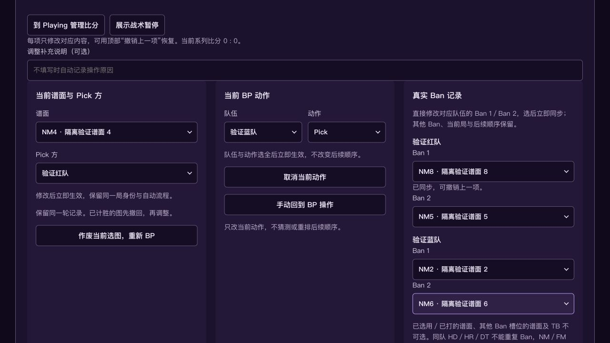

# BP 队列与 Ban 槽位修正

2026-11-04。基于 PR #12 合并提交 `729b003`。

## 操作口径

- 手动选择 Ban／Pick 是提前执行对应待处理动作。原当前动作回到队首，其余动作相对顺序保留；重复选择同一当前动作不重复入队。
- 例：B Pick → A Pick → A Ban 2 → B Ban 2，提前 A Pick 后为 A Pick → B Pick → A Ban 2 → B Ban 2。两次 Pick 实际结束后继续第二轮 Ban，再继续正常交替 Pick。
- 更多调整中的真实 Ban 记录按队伍及 Ban 1／Ban 2 直接修改，选择立即同步；支持空 Ban、未确认，保留其他槽位、当前局、自动跟随、比分和后续队列。修正旧槽位不重新推断或补造过去动作。
- 修改同步对应新旧图池标记，校验 TB、其他 Ban 槽、已选用／已打谱面以及同队 HD／HR／DT 不重复 Ban。可撤销上一项。
- 普通选图统一走图池，移除 Playing 重复的「选择本局谱面」入口。既有准备 API 继续采用相同的队列提前规则；TB 保留独立按钮。
- 仅改变播出标记的 Ban 按钮不会通过「使用刚换入的房间图」执行原先待处理的 Pick。

## 验证

- `npm run build`（包含类型检查）、`git diff --check` 通过。
- `npm test`：390 项通过，0 失败，0 跳过。执行完整测试时临时释放固定 3001 端口，完成后恢复原模拟服务。
- 新增 `test/bp-corrections.test.js` 的 9 项回归：动作提前、重复选择、撤销、后续轮换、兼容准备 API、显式手动队列、Ban 槽位修正、非法选择、历史修改后重赛及房间图入口保护。
- 浏览器使用独立内存测试会话，在 Ban 2 已有记录时将红队 Ban 1 从 NM1 改为 NM8；独立预览同步显示新 Ban，原图解除 Ban，Ban 2 与当前记录保留。
- 本机 main 服务恢复时，持久化比赛文件与备份完整一致；模拟房间从备份恢复。

本次为本机服务、浏览器与合成信号验证；未完成 Windows 原生 tosu／osu!tourney／OBS 联调。
