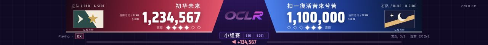

# Ranking 总分与顶部占位

2026-10-30，main。

- Playing 输出在 tosu Ranking（IPC 4）时继续读取当前双方总分和分差，控制台同步显示“本图结算总分”。
- 单图结算优先展示已保存的本局成绩；尚未保存时可展示匹配本局谱面的新鲜 Ranking 总分，无本局记录时也能显示当前房间结算。显示成绩不创建 run、不写入结果、不自动补记胜方。
- 保存成绩使用同一完整快照，缺失侧不从另一份实时样本补齐；错图、过期、断线时不使用旧的实时总分。
- 顶部两侧总分没有数据时显示 0。此处仅改变显示占位，内部仍区分缺失和真实零值，系列赢图未知值及记胜条件保持原样。

验证：类型检查、生产构建、diff 检查通过；95 项相关回归全部通过（比分显示、中途加入、自动化生命周期及赛果处理）。新增覆盖未保存成绩的 Ranking 实时更新、错图/断线清空、零分与缺失侧、已保存成绩完整快照优先。

本机现有模拟器实际处于 Ranking，未改变模拟信号或比赛记录。[浏览器检查](browser-checks.json) 核实顶部显示 1,234,567 / 1,100,000，Playing 和结算两个面板均显示分差 +134,567；当前局仍是未计胜的 ranking，系列分保留 4:3。浏览器无 error / warn。未进行真实 osu!tourney / tosu / OBS 联调。

