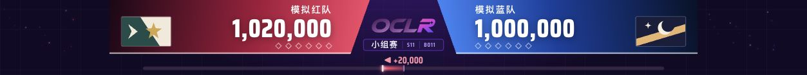

# 现场问题修复与通用同步

2026-10-31，America/New_York。本记录仅描述产品代码与验证范围，不包含现场网络配置、真实会话或原始采样。

## 修复与显示契约

| 范围 | 最终行为 |
| --- | --- |
| 自动 BP | Idle／等待客户端时的临时空选手 ID 不吞换图；实际开打、计胜仍验证有效选手 |
| 自动结算 | 已确认 Ranking 隐藏并清零聚合分数不撤销赛果；真实修改、缺失、平分与中断仍保留原有核对 |
| 回图池 | 观察到 Ranking → 房间时回图池，不等换图；明确暂停、关闭自动选画面及系列结束保持 |
| 总分 | Playing／Ranking 共用场景，最终完整队分保留到图池；不混合不完整两帧、不写胜方 |
| 队名 | tosu 左右名称同步本场显示名称，保留 ID、名单及记录；显示刷新不丢结算连续性 |
| 参数 | 实际赛事客户端的 MOD 后公共属性，缺失／混合属性显示未知，不用主控 NM 填补 |
| 背景 | 当前新鲜真实 tosu 谱面可在池外显示 BG；官方封面回退及下载期间换图核验保持 |
| 场景迁移 | map-result 旧链接、持久化场景、暂停目标、撤销状态兼容到 Playing |
| 比分 UI | 图池不显示大号比分；未开打隐藏总分及未知提示，已知零分保持 |
| 分差与捕获 | 绝对分差线性映射、明亮固定宽度端点；纯绿捕获区，坐标和尺寸保持 |
| Chat | Playing 两侧持续显示，边线断口英文标题，所有 Stream Chat 内容区留空 |
| Roll | 左右 Chat、中间横排先手；上下两列对齐，队色与放大字体 |

## 分支范围

通用修复与合成回归同步到 main。自定义测试分支继续保留独立赛事配置、BO／BP 语法、CA 类型与打包入口；不将这些预设作为 OCLR 正式规则。现场网络脚本、真实采样、会话、归档和机器地址留在本地忽略目录。

## 验证与边界

对应回归包括 ranking-return、ranking-score-hold、room-team-names、tourney-parameters、playing-ranking、artwork、live-scores，以及现有生命周期／WebSocket／持久化用例。构建包含 Vue 类型检查。main 还需要保留 Streaming API 登录、任务与导入回归，不能以测试分支旧 UI 覆盖这些功能。

真实现场出现过的隐藏清零与换图空选手事件另存于本地只读档案；离线回放使用明确标注的基线重建。采样不是完整 WebSocket 原包，不能据此声称每一路选手结束时序已完全验证。合成回归、内存回放和浏览器显示检查不等于完整 Windows 原生包实机验收；本次没有重新生成 Windows 发行包。

## 本次同步验证结果

- main：246 项非固定端口回归 + 2 项便携版生命周期／迁移回归，共 248 项通过；包含 Streaming API 登录、任务选择和导入测试。
- test/custom-match：250 项非固定端口回归 + 2 项便携版生命周期／迁移回归，共 252 项通过。队名回归使用通用 Session，不依赖自定义构造器。
- 两边 Vue 类型检查、生产构建及 diff 空白检查通过。固定 3001 用例单独执行，测试使用临时程序／会话目录。
- 浏览器检查 3v3／4v4、4:3／16:9、EX 开关八种组合：捕获均为 480×360 或 480×270，无窗口边框；Playing 单一场景且 Stream Chat 内容区全空。Roll 上下列中心线一致，先手队名为 30px。

[八组几何记录](browser-checks.json) · [Roll 对齐记录](roll-checks.json) · [Playing 示例](playing-demo.png) · [Roll 底部示例](roll-footer-demo.png)。以上均为合成布局示例，不含现场队名、聊天或比赛结果。

## 现场归档复测与补充修复（2026-10-31）

使用只读归档中的同一批3,921帧投影事件，对当前两套实现分别在内存中回放。HR2正常确认、隐藏聚合清零、返回房间及DT1空选手ID换图/后续Playing均通过；未将初始人工结果计作自动判定证据。main使用明确派生的BO11夹具和待Pick队列，不复制MP5的BO9、CA或自定义BP规则。基线时间重建及录制空白的证据边界保持。

本轮新增修复：

- 正常确认时暂存本次客户端成绩；隐藏聚合总分为零时，相同完整名单出现改变的非零成绩仍撤回自动贡献并进入核对。只有清零的显示重置继续保留结果。增加正成绩上升/下降回归；该参考不持久化，重连或成绩恰好变零的歧义不作为已解决的结束时序。
- Roll长队名最多显示两行，保留完整文本与悬停提示，22px/30px字号、红蓝队色和上下列中心保持；普通、96字和300字名称通过浏览器检查。
- 捕获主体放在底部/分差装饰光晕上层，避免阴影把边缘纯绿染成近绿色。两边八组合共16组、14,515,200个捕获像素全为纯绿，坐标和原尺寸不变。
- WebSocket测试helper只在版本竞争时有限重试，保持同一命令ID，适配房间自动发现的并发更新。

main非固定端口回归248/248、custom252/252通过；legacy migration各1项单独通过。固定3001便携版生命周期用例因已有服务占用而未运行，没有为了验证停止现场服务。两边类型检查、生产构建、diff检查通过；修复验证浏览器77项通过、0 error/warn/未捕获异常。后续顶部点缀只做了单独构建及浏览器检查，不计入此前77项或完整像素检查次数。

两边sim:timing仍为15/17，early-ipc与coherent-stale两项旧快照提前计胜风险保留；没有添加任意超时宣称解决。原始投影不含原始聊天、BG字节或MOD参数，相关合成/替身回归不能替代Windows、tosu、osu!tourney、OBS及真实Streaming授权验收。

### 顶部留白点缀

按最终反馈去除轨道和导引线，左右各16个低强度光点沿不同方向缓慢扩散、淡入淡出，11–20秒错开循环。仅在两侧空白区域使用CSS transform/opacity，严格裁切在180px头部内，aria-hidden且不接收点击；减少动态效果时静止。组件不读取或修改比赛状态。

两边构建与当前浏览器检查通过：32个粒子、0条SVG/path、位置随时间变化，捕获逻辑尺寸与纯绿计算背景保持。此次扩散调整没有重新宣称完整现场/逐像素回归。下图为独立内存会话的合成预览；现场服务未重启。

